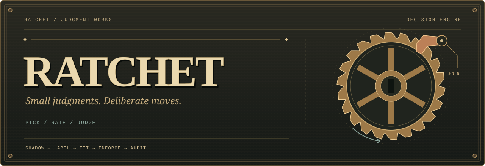

<p align="center">
  
</p>

<p align="center">
  <a href="https://www.npmjs.com/package/@jmoak/ratchet"></a>
  <a href="https://github.com/JMoak/ratchet/actions/workflows/ci.yml"></a>
  <a href="package.json"></a>
  <a href="LICENSE"></a>
</p>

<p align="center">
  <strong>The model proposes. Code decides.</strong><br>
  A decision engine for composing machine judgments, enforcing policy, and keeping the evidence.
</p>

<p align="center">
  <a href="#put-it-to-work">Install</a> ·
  <a href="#one-gate-no-api-key">First gate</a> ·
  <a href="#the-proving-ground">Arcade</a> ·
  <a href="#inspect-the-evidence">Evidence</a> ·
  <a href="docs/architecture.md">Blueprints</a>
</p>

---

## Small judgments. Deliberate moves.

A model can give you an answer and a confidence score. Your application still needs to decide when to act, when to ask, what must never happen, and whether yesterday's policy deserves today's trust.

Ratchet is that machinery. It wraps typed judgments in deterministic policy, hard floors, a decision ledger, and a measured path from **shadow** to **enforcement**. New engines start in shadow. The application remains responsible for executing the returned action.

| Part | Job |
| :--- | :--- |
| **Gate** | One decision point: its question, policy, floors, evidence, and rollout. |
| **Oracle** | Supplies a typed `pick`, `rate`, or `judge` answer. Swap models without replacing the engine. |
| **Policy + floors** | Turn a judgment into `act`, `review`, or `refuse`. Hard rules can only raise caution. |
| **Ledger** | Records the answers bought, confidence, cost, latency, recommendation, application action, and later labels. |
| **Rollout** | Uses scoped evidence to decide whether a gate may leave shadow, then monitors it with blind audits. |

## Put it to work

```sh
npm install @jmoak/ratchet
# or: bun add @jmoak/ratchet
```

**ESM · Node 22.14+ or Bun 1.3+ · TypeScript declarations · zero runtime dependencies.**

The package includes the engine and the `ratchet` CLI. Games, simulations, and experiments live in the repository. The API remains experimental before 1.0; see the [changelog](CHANGELOG.md).

## One gate, no API key

This runnable example uses a deterministic rule oracle so you can inspect the machinery without sending data to a provider. Save it as `first-gate.ts` in a project with Ratchet installed, then run `bun first-gate.ts`.

```ts
import {
  Engine, RuleOracle, State, judge, judgeIf, policyWithBand,
} from "@jmoak/ratchet";

// A scripted demonstration, not a learned confidence estimate.
const engine = new Engine({
  oracle: new RuleOracle([judgeIf(/git status/, 0.99)]),
});

const gate = engine.gate({
  id: "shell.read-only",
  question: judge("Is this command read-only?"),
  policy: policyWithBand(0.85, 0.1),
});

const state = State.create("Proposed shell command")
  .field("command", "git status")
  .build();

const result = await gate.ask(state);
console.log(result.mode, result.ruling.action, result.action);
// shadow act review
```

The policy recommends `act`; the gate stays in shadow and returns `review` as the application action. It executes no shell command. The rule above is a fixture, not a shell-security policy. A real gate needs task-specific hard floors, measured evidence, and an application that honors the result.

For a hosted model, use an [oracle adapter](docs/architecture.md) such as `jevViaOpenRouter()` with your own provider key. The [tool-gate demo](examples/tool-gate.ts) adds floors, labels, fitting, enforcement, and audits. It uses a simulated oracle unless `TYPESAFE_API_KEY` is set.

## The teeth that hold

```text
                         ┌───────────────┐
  state ──▶ oracle ─────▶│               │
                         │  deterministic├──▶ act / review / refuse ──▶ ledger
  state ──▶ hard floors ▶│     policy    │
                         └───────────────┘
```

- **Floors only raise caution.** A confident model cannot lower a refusal or review floor.
- **Fail-open means review by default.** Timeouts and malformed answers contribute no permission.
- **One-way doors stay with the human.** `oneWayDoor` places a review floor on irreversible actions.
- **Confidence has to earn its keep.** Threshold fitting prefers shadow rows and blind audits, where the oracle's confidence did not select the labels.
- **Every decision leaves a trail.** Inspect the recommendation, what the application did, and the evidence behind each.

Soft judgments are never a sufficient security boundary. Read the [binding principles](docs/vision.md) and [rollout limits](docs/rollout.md).

## Five clicks to a working policy

```text
  SHADOW ─────▶ LABEL ─────▶ FIT ─────▶ ENFORCE ─────▶ AUDIT
  observe       learn       set        act within     check and
  quietly       the truth   the bar    the policy     demote
```

A gate earns promotion through a planned acceptance test scoped to its configuration, model, and evidence phase. Changing those inputs starts a new phase. Blind audits can demote a promoted gate; disabling audits removes that monitoring path.

Save and restore the rollout checkpoint in your application. Without a valid checkpoint, the controller starts in shadow again. The acceptance test depends on stated sampling assumptions and does not certify future traffic. [Rollout and migration →](docs/rollout.md)

### Compose judgments without inventing independence

Ratchet supports ensembles, sequential sampling, cascades, verify-then-commit chains, and learned composition. Each strategy buys a different kind of evidence. Repeating the same model's answer does not make independent voters; correlation stays explicit in pooling and can be estimated from the ledger.

The [simulations](docs/sim-results.md) show where aggregation helps, where chains lose reliability, and where calibration or correlation breaks the premise. The [recipe catalogue](docs/idea-catalog.md) maps practical uses to the primitives.

## Shadow your coding agent

```sh
npm install -g @jmoak/ratchet
ratchet hook claude-code install
# or: ratchet hook codex install
```

`install` prints configuration for you to apply. Hooks journal prompts and subsequent events; they do not enforce decisions. Replay can evaluate settled prompts in shadow and label them from what happened afterward. An inferred denial still needs blind review to distinguish a rejected action from a change of plans.

Dry runs show the scrubbed subject before any live request. Live replay uses your provider and a spend cap. See the [hook guide](docs/design/agent-hook.md) for payload handling, label inference, and setup.

## The proving ground

Four local browser games make the engine visible. Each opens on its result: one seeded world run without the engine and with it, then the same duel in hundreds of worlds, with levers to move and a target to beat. Every decision passes through real `Engine` and `Gate` instances, with an inspectable in-memory ledger. No API key is needed for the arcade.

```sh
git clone https://github.com/JMoak/ratchet.git
cd ratchet
bun install --frozen-lockfile
bun run arcade
```

Open **http://127.0.0.1:3210**. Stop with Ctrl+C; set `ARCADE_PORT` to change the port. The server binds to loopback, and the judges are seeded simulations with known error rates.

| Game | The duel | At the defaults |
| :--- | :--- | :--- |
| **Bridge Builder** | Lay ten spans and walk, or verify each piece before building on it. | Crossed 17% → 69% |
| **Signal Orchard** | Pool five alike scouts as five, or as what is independent. | Ripe picks 90% → 99%, both claiming 98% or more |
| **Parcel Patrol** | A persuadable judge alone, or the same judge under rules in code. | Bad parcels shipped 33 → 9 in 100 |
| **Treasure Survey** | Promote when it looks good, or plan the test and keep auditing. | Worse Scouts promoted 99% → 3% |

[How the arcade works](docs/arcade.md) · [Decision-trail viewer](docs/cli.md)

## Inspect the evidence

The repo includes seeded simulations, authored application scenarios, and recorded live-model runs. Those answer different questions.

The [first live shadow pilot](docs/pilot-results.md) used 54 authored scenarios and 43 model requests. Every actual application action remained `review`. Its results demonstrate the end-to-end workflow; those small, related samples do not establish production accuracy.

| Read | Learn |
| :--- | :--- |
| [Live findings](docs/live-findings.md) | What the model did across the recorded calibration and composition experiments. |
| [Pilot results](docs/pilot-results.md) | Frozen recommendations, case counts, failures, and limits. |
| [Live recipes](docs/live-recipes.md) | Which application patterns were actually measured. |
| [Ledger CLI](docs/cli.md) | Report, check, replay, review, trace, and calibration profiles. |
| [Architecture](docs/architecture.md) | The public API, execution paths, and source ownership. |

## At the workbench

From the source checkout:

```sh
bun run check       # types, lint, tests
bun run sim         # seeded simulation tables
bun run demo        # full gate lifecycle; simulated unless a live key is set
bun run pilot       # offline shadow pilot and acceptance experiment
bun run pack:check  # inspect the distributable; does not publish
```

Live quickstarts and experiments call paid backends. Keep them explicit. See [development dependencies](docs/dependencies.md), [agent conventions](AGENTS.md), [the roadmap](docs/roadmap.md), and [publishing](docs/publishing.md).

## License & providers

Apache 2.0: [LICENSE](LICENSE) and [NOTICE](NOTICE). Quoted third-party material in the research notes and reports belongs to its respective owners.

Ratchet is independent of the model providers it supports and ships no model. Hosted adapters send the state you supply to your chosen provider under your own account. Read [third-party services and terms](docs/third-party-terms.md) before using or hosting a provider-backed integration.

---

<p align="center">
  <strong>Click. Check. Advance.</strong><br>
  <sub>ratchet · small judgments, deliberate moves</sub>
</p>
