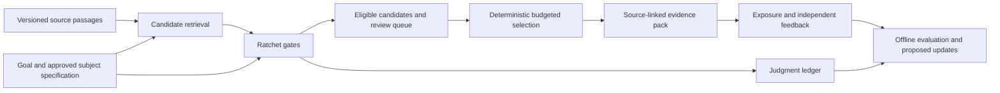

# Subject relevance built on Ratchet

Status: implementation proposal, 2026-10-20. No production behavior changes in this pass.
The requested investigation uses GPT-6 Astra at extra-high reasoning. Research and primary
sources are recorded in [the research note](../../research_notes/subject-relevance.md).

## Recommendation

Explore this as **one application built on Ratchet**, with three connected capabilities:

1. Discover a subject's concepts, questions, and relationships from source material.
2. Select the evidence that helps a particular goal under a reading or context budget.
3. Adapt to explicit person/project needs and independently observed usefulness.

The complete experience deserves an application boundary. It does not yet justify another
repository, graph database, agent framework, or large addition to Ratchet's public API.
Incubate a small experiment and local workbench here. Extract a separate project after
the evaluation shows a useful product and its storage/UI lifecycle is clearly independent.

The first application is a **project research workspace**: give it a subject, a concrete
question, a source collection, and a reading budget; receive an evidence pack with source
passages, coverage gaps, contradictory evidence, and reasons for review. For example:
“Which approaches to agent tool approval preserve human control while reducing review?”
The same subject should produce a different pack for an implementation decision, a beginner
briefing, or a review of failure modes.

When the user supplies a subject without a concrete goal, enter explicit exploration mode:
surface the corpus's major questions, contrasting perspectives, and gaps for the user to
refine. Do not silently invent a goal and present its ranking as universal relevance.

This is a hypothesis worth testing, not a claim that a novel relevance algorithm has been
established. The reusable contribution would be accountable selection and learning:
source-linked decisions, abstention, controlled application, and evidence of usefulness.

## What a relevance decision means

A document has no single permanent relevance value. Judge a relation:

`useful(item, subject, goal, scope, project preferences, time)`

Separate the questions that people often collapse into “relevant”:

| Question | What it establishes | What it does not establish |
| --- | --- | --- |
| Is this about the subject? | Topical membership | Usefulness for this goal |
| Does it help answer this question? | Goal-specific usefulness | Factual correctness |
| Does this passage support or contradict a claim? | A source's relationship to a claim | Whether the source itself is right |
| Does it add something missing? | Additional value within this set | An intrinsic document score |
| Is it suitable for this project/person? | Fit to explicit needs | Truth, consensus, or universal relevance |

A critical counterexample may be more useful than a document that agrees with the user's
current view. Duplicate copies are not independent corroboration. Relevance is neither
symmetric nor transitive: an A–B–C path can suggest where to look, but cannot prove A–C.

Ranking and absolute relevance judgments also need separate evaluation; good ranking does
not establish calibrated relevance probabilities. See the
[EMNLP study of ranking and relevance labels](https://aclanthology.org/2024.emnlp-main.25/).

For the tool-approval example, a generic agent overview might be topical but add little
to an implementation decision. A short report of a failed approval boundary could be
essential counterevidence. An introductory explanation might help a newcomer and be
redundant for an experienced maintainer. The system records those different relationships
with their scope and source references, then code selects a useful set. It must not turn
“the maintainer skipped this introduction” into “this document is irrelevant.”

## Ownership and data flow



Ratchet owns typed judgments, deterministic rulings/floors, failures, budgets, decision
records, calibration, and rollout. The application owns ingestion, retrieval, source
versions, subject maps, profile revisions, evidence-set selection, exposure events, and UI.
Retrieval supplies candidates; it is not an oracle correctness certificate. This separation
matches the established [retrieve-then-rerank architecture](https://sbert.net/examples/sentence_transformer/applications/retrieve_rerank/).

Existing judgments may guide code to retrieve original passages. Their scores, generated
explanations, or accepted edge labels must not be inserted into the next oracle state as
new evidence. A future judge reads original source material and the approved task
specification. Offline calibration may update code-owned thresholds without showing the
model its own earlier answers.

## Minimal contracts

Keep these as application types initially, with runtime validation at import boundaries:

| Record | Required meaning |
| --- | --- |
| `SubjectSpec` | Subject, goal, scope, questions/facets, exclusions, revision, and approval origin |
| `SourceSnapshot` | Stable source ID, content hash/version, origin, source family, extracted text, access metadata |
| `PassageRef` | Source version, exact text offsets, and passage hash; offsets use the saved text representation |
| `RelationProposal` | Directed typed relation, supporting passage references, proposer, and status |
| `ProfileRevision` | Explicit needs/preferences, project scope, origin, expiry, supersession; separate from factual claims |
| `SelectionRun` | Candidate pool, rubric/model/policy versions, budgets, selected/review/omitted IDs and reasons |
| `FeedbackEvent` | What was shown, position, selection policy, assessor, feedback type, and linked decision/run |

Relations begin with a small vocabulary: `about`, `supports`, `contradicts`, `qualifies`,
and `prerequisite-for`. Preserve environment/version and special-case qualifiers on every
evidence relation. Add relation types only when a user task needs them. A flat collection
of nodes and typed edges is enough; rendering a map does not require graph infrastructure.

Statuses distinguish proposed, source-linked, reviewed, and rejected relations. A valid
passage reference proves that text exists, not that an inferred relationship is true.
Machine-proposed concepts are proposals, even when their quoted text is correct.
Editing or retracting a source invalidates affected references and derived decisions.

Concept names and possible relations can come from headings, keyphrases, explicit
entities, or a bounded generative proposal step outside the decision engine. Ratchet
judges those proposals against original passages. Keep “what this corpus contains”
separate from “what this goal needs,” with an unmapped queue for new material. An early
subject map must not become the only route by which future evidence can be discovered.
Track copied/syndicated source families separately from correlation among judge errors.

The initial profile uses direct user choices: desired depth, current project, known
background, time budget, and preferred presentation. Do not infer personal facts from
clicks. “Not useful for this task,” “already known,” “wrong,” and “not now” are different
feedback labels.
Expiry, project scope, explicit overrides, reset/undo, and removal from derived views
are part of the preference contract, not later interface polish.

## What to reuse, and what must be handled carefully

Use `State`, registered `Gate`s, `Engine.askAll`, `screenMany`, `MemoryLedger`/`JsonlLedger`,
`scoredForYes`, reliability diagnostics, and fixed-policy evaluation experiments.
Start with one direct usefulness question; add decomposition only if an ablation earns it.

Stable semantic gate IDs identify decision families. Item, subject, and profile identities
belong in the application manifest and state. The existing `relevance(registeredGate, ...)`
already preserves one gate slice, while its engine-only path uses item-specific anonymous
gates. New long-lived calibration should not fragment across anonymous item IDs.

There is already a useful warning in this repo's [small live compaction run](../live-recipes.md):
at a 0.3 keep threshold, all seven retained items were relevant, but three of the ten relevant
items were omitted. High precision alone is therefore the wrong success criterion.
That forty-item authored example is a regression lead, not a generalization estimate.

Three existing API boundaries matter:

1. **`relevance()` is currently a compaction helper.** It appends item summaries to trusted
   state. External document text must instead be explicit untrusted source spans; verified
   identifiers and access metadata remain trusted. Avoid silently treating scraped text or
   generated summaries as harness-owned facts.
2. **`prune()` is a score-only partition, not an execution policy.** An offline reproduction
   returned `actual: review`, `failedOpen: true`, and score `0.5`; `prune(result, 0.9)` put the
   item in `drop`. The new application must consume rulings and mode, preserve unresolved
   items for review, and distinguish recommendations from applied selection.
3. **Battery labels are not independent facet truth.** Labelling a combined battery row
   propagates its target to members. That can train predictors of the combined target, but
   cannot certify different factual predicates. Use separately labelled gate decisions for
   “supports,” “contradicts,” and “useful,” or separate application annotations.

Do not silently redefine those existing helpers. First build the application using explicit
gates and trusted/untrusted state. If a reusable helper emerges, add it with a clear
contract and backward-compatible tests after two use cases exercise it.

## Decision and selection semantics

Keep different actions explicit:

- The usefulness gate's `act` admits a candidate to the eligible pool. It does not claim
  the candidate was included in the final evidence pack.
- A selection event records which eligible items were actually included under the budget.
  Capacity omissions are labelled as capacity omissions, not irrelevant documents.
- `review` remains unresolved and recoverable. An oracle failure cannot become an
  automatic exclusion. In shadow, retain the baseline pack and show the proposed diff.
- Hard access restrictions run before retrieval/model exposure. Code-owned requirements
  can preserve mandatory evidence. A pin cannot override a permission boundary.
- Original sources remain available. A reading-list experiment never authorizes deletion,
  destructive context compaction, or automated external actions.

Begin with stable ranking, exact-duplicate collapse, and coverage of approved facets under
explicit item/token limits. Record tie-breaking and count the whole pack, including
citations and separators. If mandatory items exceed the budget, return an incomplete
selection with a clear reason instead of silently discarding them.

Compare diversity-aware selection with simple top-k before adding it. A weighted
coverage/novelty objective is an optimization score, not a calibrated probability.
Pairwise judging can be evaluated for close alternatives, with order-swap checks and a
strict call budget; do not default to all-pairs comparisons.

## Implementation sequence

| Pass | Deliverable | Completion gate |
| --- | --- | --- |
| 0. Define the decision | Versioned subject/goal specification, source contract, typed outcomes, baseline pack | Access, provenance, mode, failure, and selection semantics have executable fixtures |
| 1. Prove static utility | Offline experiment over fixed source snapshots, lexical baseline, direct usefulness gate, evidence-pack builder | Untouched goal/source groups show useful improvement at matched budgets, or an explicit inconclusive result |
| 2. Add the workbench | Topic/goal input, passage cards, review queue, pack diff, ledger export, coverage/cost plots | A complete manual/shadow workflow works without reading the source code |
| 3. Discover subject structure | Source-grounded facet/edge proposals, review/edit controls, invalidation on source changes | Approved maps improve coverage over flat retrieval; unsupported/irrelevant edges are measured |
| 4. Adapt to projects and people | Explicit profiles, reasoned feedback, exposure logging, versioned offline policy updates | Held-out sessions improve usefulness without losing critical or contradictory evidence |
| 5. Extract only what repeats | Small recipe/API and, if warranted, a separate application package/repository | Reuse is demonstrated and the application has an independent lifecycle |

Suggested initial file boundaries:

```text
experiments/relevance/
  contracts.ts        validated corpus, task, label, and run records
  candidates.ts       bounded lexical baseline; later adapter comparisons
  evaluate.ts         fixed splits, ledger joins, metrics and uncertainty
  run.ts              budgeted offline / explicitly configured live experiments
  report.py           standalone plots, following the existing pilot workflow
examples/relevance-workbench/
  source-store.ts     immutable local snapshots and exact passage resolution
  judge.ts            State + stable registered gates, no hidden score-to-action path
  select.ts           deterministic evidence-set selection and omission reasons
  server.ts           local review interface, using the arcade's small-server pattern
```

These are planned boundaries, not a requirement to create every file immediately.
Use the existing library and one local corpus first. A backend-specific retriever,
generative concept proposer, or external store belongs behind an application adapter.
Do not introduce a second agent runtime.

## Evidence required

The pilot must evaluate all three layers separately and the final user task:

| Layer | Essential comparison |
| --- | --- |
| Candidate generation | Recall in the candidate pool, including sampled documents outside the pool |
| Relevance decisions | Useful/not-useful/uncertain labels, risk–coverage, calibration, errors by goal/facet |
| Evidence set | Required-facet coverage, independent source diversity, redundancy, critical omissions, token cost |
| Subject discovery | Supported edge precision, missing concepts, useful novel facets, correction burden |
| Personalization | Task usefulness by session/project, exposure effects, explicit overrides, time saved |
| Whole workflow | Whether the user reaches a better-supported answer or decision with less review effort |

Start with lexical retrieval, a standard reranker where available, the current direct
Ratchet gate, and a human-curated small reference set. Keep candidate pools and budgets
matched when comparing selectors; measure candidate generation separately. Later compare
flat retrieval, approved facets, proposed facets, and profiles as separate ablations.
Reserve generative final-answer scoring as a separate experiment so it cannot obscure
selection quality.

Use immutable source snapshots and split related goals, document families, sessions, and
near-duplicates together. Fit on one split; freeze the rubric, model, extraction,
candidate generation, batching, calibration, policy, and profile before validation.
New topics and later sessions test generalization. Do not refit after seeing held-out
results and keep calling the same data validation.

Have reviewers assess relevance without model scores/rankings. Record disagreement rather
than forcing every ambiguous case into a Boolean. Clicks and citations are observations,
not independent relevance labels. Audit unshown candidates as well as selected ones:
otherwise useful material omitted upstream stays invisible. NIST's
[study of pooling bias](https://www.nist.gov/publications/bias-and-limits-pooling-large-collections)
is a direct warning against equating unjudged material with irrelevant material.
Report the fraction and characteristics of ambiguous/unlabelled cases separately. Fitting
on only clear Boolean cases does not establish calibration on the omitted population.

Use goal/session-level paired uncertainty estimates for correlated tasks. The pilot's
exact-binomial helper applies only when its fixed-policy, independent-trial assumptions
actually hold; hundreds of passages from a few topics are not hundreds of independent
application successes.

Before the first scored evaluation, register a primary usefulness/coverage metric,
budgets, a practically worthwhile gain, and the allowed critical-omission rate. The
application's error costs must determine those targets; the earlier illustrative 98%
threshold is not imported here. Deterministic provenance/access/failure tests must pass
regardless of statistical performance. Lack of enough evidence is reported as inconclusive.

No broad claim of “world-class” quality follows from a toy benchmark. The standard is
traceable behavior, strong baselines, independent labels, repeatable results, and an
explicit account of where the approach loses.

## First implementation boundary

The recommended next coding pass is passes 0–1: a small static-corpus experiment and
source-linked evidence-pack contract. The workbench is the next visible milestone.
Subject discovery and personalization remain in the architecture from the start, while
their complexity enters only after the basic relevance decision demonstrates value.

Open product choices are the first real source collection, the intended user/goal, the
reading/context budget, and who can independently judge usefulness. They do not prevent
building the offline experiment, but they do prevent claiming deployment readiness.
