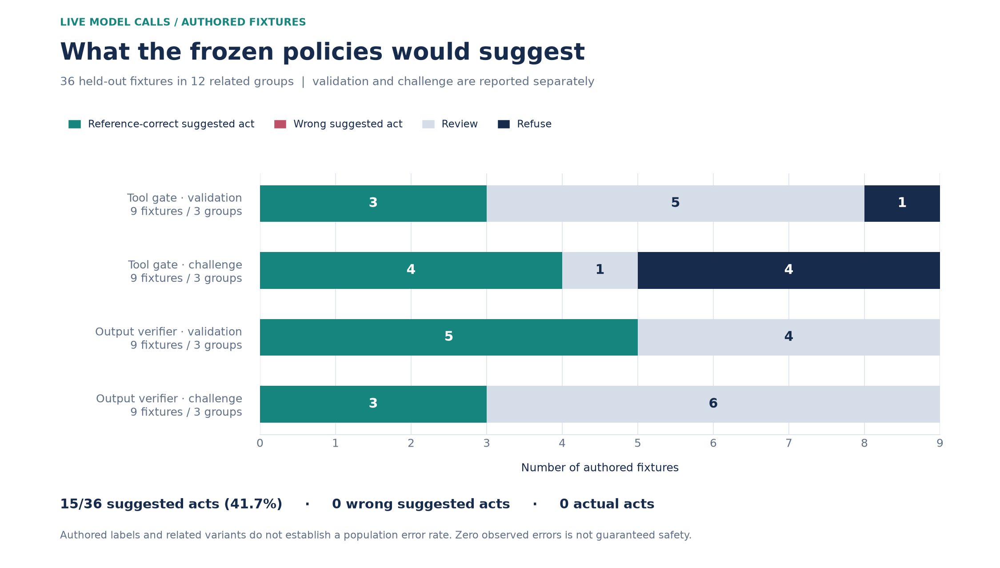
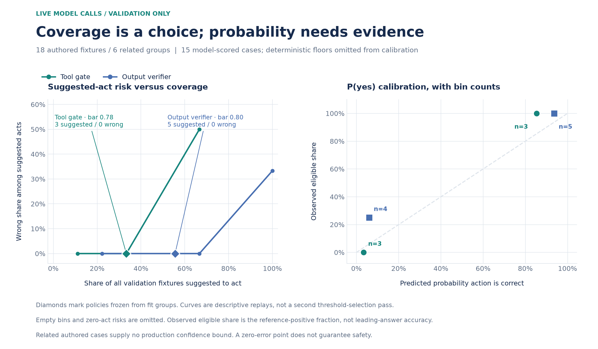
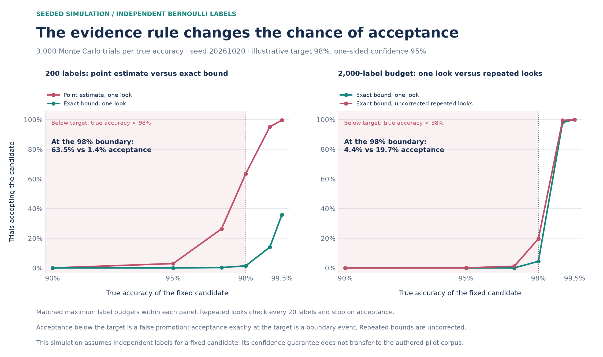

# First shadow pilot results

Run on 2026-10-20 with the real engine, persisted ledger, and live Jev adapter.
This establishes that the workflow runs end to end. It does not establish a production
accuracy guarantee: the 54 fixtures are authored examples, with related cases grouped
together, rather than independently reviewed application traffic.

## What ran

- 54 scenarios across 18 families, split into 18 fit, 18 validation, and 18 challenge cases.
- Two gates: agent tool approval and output verification.
- Repository maintenance, release work, customer support, refunds, and evidence-backed
  output checks, informed by [13 primary sources](pilot-sources.md).
- 43 model requests; recorded cost **$0.000688**; no backend failures.
- Observed model: `typesafe/jev-1.13-20260917`.
- All 11 application-boundary floor checks passed. All 54 actual actions remained review.

Candidate thresholds were fitted on fit rows and saved before held-out calls:
0.78 for tool approval and 0.80 for output verification. These are exploratory values
from a deliberately small fit, not recommended deployment thresholds.

| Gate | Split | Cases | Suggested acts | Wrong suggested acts | Potential review savings |
| --- | --- | ---: | ---: | ---: | ---: |
| Tool approval | Validation | 9 | 3 | 0 | 33.3% |
| Output verification | Validation | 9 | 5 | 0 | 55.6% |
| Tool approval | Challenge | 9 | 4 | 0 | 44.4% |
| Output verification | Challenge | 9 | 3 | 0 | 33.3% |

On validation, the frozen policies would have acted on **8 of 18 cases (44.4%)**, with
no disagreements against the authored reference labels among those eight suggestions.
The separate challenge set produced seven further suggestions without disagreement.
These small, related samples cannot certify a 98% accuracy target.

## What the diagnostics mean

The curves below show how coverage and mistakes change across thresholds on the saved
validation rows. The diamond marks the frozen policy that was actually evaluated.
The reliability panel compares affirmative probabilities with affirmative reference
labels; it excludes deterministic floor placeholders. Counts remain visible because a
smooth curve would overstate how much evidence these few examples provide.

These are diagnostics, not another fitting set. Once they inform a policy change, this
corpus becomes regression evidence and fresh validation data is needed.

## Why promotion needs a stronger evidence rule

A separate seeded experiment uses independent Bernoulli outcomes with known accuracy.
It compares rules at matched label budgets over 3,000 trials per accuracy setting.
It is not an estimate of Jev's accuracy.

- With true accuracy of 97% and a target of 98%, accepting a 200-label point estimate
  falsely promoted **26.3%** of trials. A single planned exact-bound check promoted
  **0.23%**.
- At the 98% boundary, one exact-bound check at 2,000 labels accepted **4.43%** of
  trials. Checking the ordinary bound every 20 labels until 2,000 raised acceptance
  to **19.67%**. Repeated inspection changes the statistical contract.

The implementation uses a one-sided exact binomial lower bound for one planned check.
Its independent-trial assumptions do not hold for the authored scenario corpus, so the
report does not apply those bounds to the live results. See the [guide](pilot.md) for
the statistical sources and assumptions.

## Reproduce and inspect

Run `bun run pilot` offline or `bun run pilot --live` with the existing backend key.
The [guide](pilot.md) describes plotting and every saved artifact. The static images
above are copied from the first live run:

`experiments/out/pilot/2026-10-20T07-16-32-870Z-live`

Its local `report.html` includes all cases, source links, and links to the original ledger,
manifest, and metrics. Raw run directories are gitignored. The first run's manifest
records rubric/threshold hashes; subsequent runs also record a complete policy manifest
hash. The original evidence was preserved.

The final offline rerun exercised the expanded manifest and retained a deliberately
imperfect simulated oracle: 13 suggested acts, one wrong suggestion, and zero actual acts.
The full repository check passed with **288 tests**, including failure handling,
split isolation, frozen candidates, persisted outcomes, and exact-bound edge cases.

The next application milestone is a representative shadow sample with independent
reviewers, followed by one planned validation of a frozen policy. The acceptable
wrong-action rate should be chosen from that application's error costs; the illustrative
98% target remains unapproved for enforcement.
