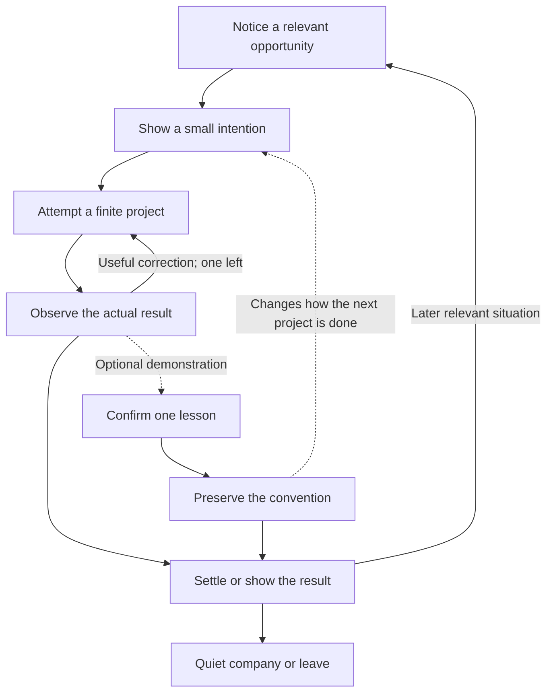

# Pebble: small ideas, visible consequences, lasting influence

Research and proposed design, 2026-10-20. The user's priority is watching Pebble pursue its
own small ideas, then teaching it something it applies later. Direct shared play is optional.
This map supersedes the reciprocal-return-first priority in [the earlier synthesis](pebble-play-design.md).
Three Astra research agents reviewed connected loops, growth and feasibility. Nothing here
is implemented or measured evidence of fun, attachment or retention.

## The direction

Make an autonomous creature whose modest projects are understandable, whose outcomes matter
to its next action, and whose way of doing things can carry the player's explicit influence.
A person should be able to watch a complete episode without clicking. Teaching changes a
future choice; it does not become a requirement to keep the creature moving.

The central tension is useful: **the player influences how Pebble pursues an idea while
Pebble retains bounded initiative over when to pursue it.** Current direct invitations and
care needs still take priority. Initiative is authored behavior over known opportunities,
not a claim that the creature invents arbitrary goals.

The growth cycle has two clocks: an episode completes in a short visit, while a convention
can survive indefinitely. Familiar competent behavior remains available after learning.

These nodes describe behavior, not mandatory UI steps. The dashed teaching path is optional.
An interruption may end any phase. A resting, content creature is a valid endpoint.

## First experiment: a little stone place

Pebble notices the box and the grouped stones, looks between them, arranges the stones
beside the box, then steps back to inspect its work. It can finish and settle without a
response. This reuses `inspect`, `arrange` and `present`; the stones remain one grouped
object initially. Moving that group is a new effect: today's arrangement only changes a
pattern, so this requires real world-state and motion changes.

The player can move the stones to another supported resting place and explicitly choose
“Remember it this way.” A preview shows the exact relationship being remembered. Start
with one simple relation, such as spacing in front of the box along a fixed, visible box
orientation. Do not silently mix screen-left, creature-left and approach-relative left.
The first test supports translation, not arbitrary orientation or novel construction.

Later the box is elsewhere. When an appropriate opportunity arises, Pebble independently
uses the taught spacing in the new place. Two otherwise identical histories—close spacing
versus wider spacing—produce visibly different arrangements at the same new box position.
This is explicit parameter adaptation with authored spatial transfer. It is not motor
learning or a learned theory of geometry.

The small maker is the cheapest test of **readable initiative plus consequential influence**.
It is not the proposed full game, and a saved arrangement may still feel like a setting.
That limitation is a reason to compare it with a fixed, equally polished creature before
adding a growth system.

It tests autonomous execution of an available project, not sustained invention. After the
place is complete, another maker episode usually needs a relevant scene change. Record
whether a project was available when evaluating a revisit; an idle scene and an unwelcome
episode are different findings. Later, an arrangement could itself create an opportunity
to test the passage with the ball. That is a consequence connecting two bounded projects,
not permission for an endless chain or an unseen new capability. Longer autonomous variety
will require additional well-authored opportunities or richer rules; it is not supplied by
the first stored convention.

### An illustrative visit

- **First encounter:** Pebble glances between the objects, makes its place and inspects it.
  The person can watch the entire episode. Timing is tuned for readable action, not a quota.
- **Optional intervention:** the person demonstrates wider spacing and confirms it. The
  current arrangement stays where they put it; ordinary dragging alone teaches nothing.
- **A later situation:** the box moves. Pebble starts a new project when free and applies
  the same spacing at that location. The person sees their influence without repeating it.
- **After familiarity:** the person can enjoy the ritual, revise the convention, arrange a
  new situation or leave. There is no demand to make the next attempt harder.

Do not turn Pebble into an automatic tidier. A player's direct edit takes precedence and
cancels the affected project. It must not immediately restore its preferred layout. A stored
convention is a preference used for a future eligible project, not an invariant enforced on
the room. Reopening, a clock tick or a care action must not fabricate a new project trigger.

## Connected loops and what each adds

| Loop | What Pebble does; what the person can do | What changes | Choice after familiarity | Dependency and main risk |
| --- | --- | --- | --- | --- |
| **Make a place** — first experiment | Notice the objects, arrange, inspect and settle. The person watches, redirects or explicitly teaches spacing. | One confirmed relation affects later independent arrangements. | Keep its familiar style, revise it or arrange a situation where the old idea no longer fits. | One finite project, a movable grouped prop and confirmed relation. May feel like a layout preference with animation. |
| **Make, then try** — preferred extension if initiative is appealing | Arrange a small passage, roll a ball through, inspect the actual contact, then make at most one useful adjustment. The person can demonstrate another spacing or move the destination. | A physical result affects the next action. The layout becomes something Pebble uses. | Choose close-fitting or generous arrangements; see whether a familiar convention works elsewhere; help or watch an imperfect attempt. | Real grouped-stone geometry, a bounded rolling path and outcome records. May become a one-solution fit puzzle or repeated laboratory demonstration. |
| **Find, then continue** — alternative if attention is appealing | Notice that the ball needed for its project is missing, check its last observed location, inspect once or seek a clue, then resume or settle. The person can point, reveal or watch. | A new observation changes the search and permits continuation. | Change what Pebble witnesses and how much help to give. Familiarity lets the person anticipate its belief. | Legible attention, occlusion and a limited observation view. One hiding place is quickly exhausted; random wrong guesses are not depth. |

The second and third rows are branches, not a commitment to build both. They should inherit
the same attention, interruption, observation and explicit-teaching rules. The return game
remains a useful optional interaction and transfer fixture, but it is no longer the product's
center. Avoid a menu of unrelated minigames.

For **make, then try**, retain the grouped stones if possible: add one bounded spacing
parameter and collision shapes consistent with the drawing before individual construction.
An actual blocked roll can justify widening the passage once. This is authored feedback
control unless a separately tested predictor genuinely changes. Never manufacture a miss,
secretly alter physics or erase an old skill to make improvement visible.

For **find, then continue**, the world may know the hidden ball position for rendering and
collision checks; the behavior selector must not. Its input is visibility and last-observed
facts. The same limit applies to any model-facing state. Today's observation exposes every
object position, so a search animation alone would not establish this mechanism.

## Growth without a level ladder

| What grows | Evidence that permits a change | State consequence | What must not stand in for it |
| --- | --- | --- | --- |
| **Player understanding** | The person predicts an intention or explains a transferred relation. | Usually none; this is research evidence, not a hidden player level. | Click count, time open or guessed emotional engagement. |
| **A convention** | An explicit confirmation of a specific demonstration. | Replace one bounded relation, retaining its event identity and version. | Watching, petting, ordinary movement or autonomous repetition. |
| **Practical knowledge** — later | A valid physical observation, such as a ball contacting the current passage. | Update knowledge of that geometry; invalidate it when geometry changes. | A judge's approval, a caption or a success counter. |
| **Motor competence** — optional later | Valid unconstrained motion observations improve held-out predictions. | Update the actual controller used for subsequent attempts. | Censored/captured rolls, staged clumsiness or animation unlocks. |
| **Room possibilities** | A supported object relationship becomes available through a real scene change. | Another eligible project or variation; no extra capability is invented. | Parameter combinations counted as automatically interesting content. |

The cycle across visits is **notice → try → understand → retain what matters → reuse in
another situation**. It can also branch from understanding directly to familiar repetition
or quiet company. No visit number, elapsed day or practice count gates the branch.

When the first skill is mastered, leave it mastered. A later encounter can change its use,
the surrounding geometry, the creature's chosen goal or the player's convention. If those
changes all feel equivalent, the mechanism has reached its depth ceiling. More variations
should not be presented as evidence that the ceiling disappeared.

The autonomous selector needs only a small eligibility rule: comfortable and unoccupied,
relevant observable opportunity, supported feasible project, no conflicting player edit
for that opportunity generation, and no already-satisfied goal being regenerated. A manual
edit closes the affected opportunity; elapsed time alone never reopens it. Start one project; execute at most
one useful revision; settle. A bounded active-time cooldown and opportunity identity prevent
repeated prompting. The PRNG may vary equally eligible authored choices, never outcomes.

Do not maximize learning progress as the pet's sole purpose. A familiar episode may be
pleasant after prediction error stops falling. For this scope, curiosity can be an authored
proposal to try one supported variation. Only call it learning-driven exploration if a
measured learning-progress signal actually selects the action and improves behavior.

## Evidence connections that change the design

| Primary source | Connection to this proposal | Limit |
| --- | --- | --- |
| Dragan, Lee and Srinivasa, HRI 2013: [Legibility and Predictability of Robot Motion](https://publications.ri.cmu.edu/storage/publications/pub_files/2013/3/legiilitypredictabilityIEEE.pdf) | Goal-expressive motion differs from merely expected motion. Test whether the glance and approach let a viewer anticipate Pebble's project before a caption explains it. | Robotic-motion experiments; no evidence that our animation will be engaging. |
| Knox and Stone, K-CAP 2009: [TAMER](https://www.cs.utexas.edu/~bradknox/papers/kcap09-knox.pdf) | Human feedback and environmental outcomes carry different information; delayed feedback creates a credit-assignment problem. Bind a teaching confirmation to an exact demonstration. | Their learning framework is not needed for storing a narrow convention; training feasibility is not enjoyment. |
| Cakmak and Thomaz, HRI 2012: [Robot Learners that Ask Good Questions](https://homes.cs.washington.edu/~mcakmak/pdfs/2012/cakmak2012hri.pdf) | Ease of answering and perceived intelligence differ across question types. Prefer an occasional concrete preview over repeated requests for instruction. | Robot teaching tasks, not a prescription for how frequently a pet should ask. |
| Oudeyer, Kaplan and Hafner, 2007: [Intrinsic Motivation Systems](https://adapt.informatik.hu-berlin.de/pub/papers/ims.pdf) | Their experiments distinguish learning progress from attraction to novelty or unpredictability. Separate a useful experiment from a random action. | Autonomous development evidence does not establish human entertainment or justify an RL stack here. |
| Nintendo's [New Leaf creator interview](https://www.nintendo.com/en-gb/Iwata-Asks/Iwata-Asks-Animal-Crossing-New-Leaf/Animal-Crossing-New-Leaf/6-Playing-the-Whole-Year-Round/6-Playing-the-Whole-Year-Round-738875.html) | Interacting elements and a player-authored world are useful precedents; the creators also describe substantial content production. | A small systemic toy cannot assume comparable longevity without that work or new evidence. |

The earlier [attachment](../research_notes/pebble-attachment-research.md),
[play](../research_notes/pebble-play-research.md) and
[return](../research_notes/pebble-return-research.md) reviews retain their evidence caveats.
The map's particular loops and ordering are design inferences, not findings from those studies.

## Small implementation boundary

Add one app-owned project record with kind, phase, anchor, captured geometry, attempt count,
termination reason and generation identity. Keep one convention with a coordinate-frame
version and confirmation event. Preserve actual effects and applied-event identities with
the save, so retries and restore cannot teach or complete the same event twice.

Freeze a placement or roll's target at execution; it must not chase a moved anchor in flight.
Manual edits invalidate affected pending steps. A stale confirmation must not apply to a new
scene, and saving mid-project must retain its captured intent rather than reconstructing it
from a newly taught preference. Self-care can interrupt; unfinished work is not recorded as
completed. Reuse the existing clock and revision discipline rather than adding a second loop.

Ratchet continues to own semantic judgment and its ledger. Project selection, finite effects,
world observation and convention updates remain application code. A project-level gate must
describe the exact bounded capability being authorized; later phase preconditions remain code
checks. A held proposal cannot become permission for that project through a timeout fallback.
The current request spacing and action-duration contract need an explicit review if one
project contains shorter beats. No model call belongs on each animation frame.

Future language input might choose among supported project variants, but it must beat the
same explicit-control baseline. The initial initiative and teaching test needs no live call,
new engine primitive, broad memory service, general planner or relationship score.

## Experiments and investment decisions

1. **Verify mechanism before people.** Give identical scenes two teaching histories; move
   the box to unseen valid positions; inspect later autonomous placement. Compare with
   absolute-coordinate replay. Also test blocked placement, interruption and restore.
   This proves bounded transfer and reliability, not depth or fun.
2. **Test readable independent action.** With a small formative group, let the project run
   without instruction. Before showing an explanation, ask what Pebble appeared to be doing.
   Record whether watching is welcome and where attention or understanding breaks.
   Freeze practical proceed/stop criteria before sessions. Allow one focused repair of
   expression or control, then reassess; repeated redesign cannot stand in for a positive
   result. Count eligible opportunities separately from completed or watched episodes.
3. **Test influence separately.** Compare the same polished project with a fixed convention
   and an explicitly teachable one; counterbalance order. Keep capability and variation
   comparable. Ask whether they recognize their influence in a changed scene and choose to
   watch or guide another episode. These are exploratory observations, not effect estimates.
4. **Choose one branch.** If independent projects appeal but teaching feels like settings,
   test make-then-try to add a consequential project decision. If attention and anticipation
   appeal more than arrangement, test find-then-continue instead. If even the readable project
   is dull, change the activity before expanding its memory. If initiative itself is unwelcome,
   reconsider the autonomous-project direction.
5. **Observe optional revisits only after the episode works.** Freeze the build, permit
   short or quiet visits, and ask returners and non-returners what drew or displaced them.
   A roughly six-person formative tranche can find failure mechanisms; it cannot establish
   durable retention. Use the earlier return protocol without mandatory sessions or content drip.

The next implementation target is the small maker experiment. Make-then-try and search remain
conditional. This pass delivers research and a growth map only; no app behavior, user data,
publishing, paid calls or model rollout changed.
